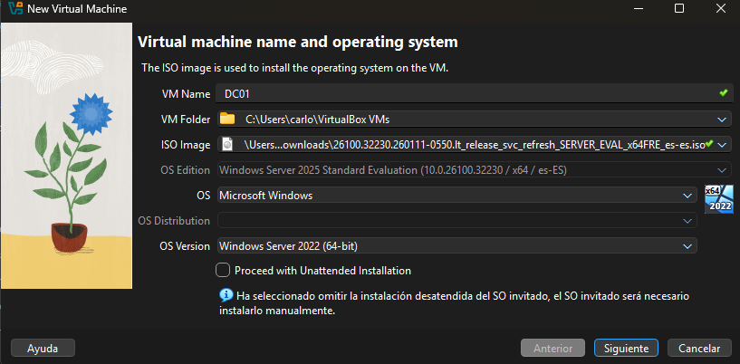
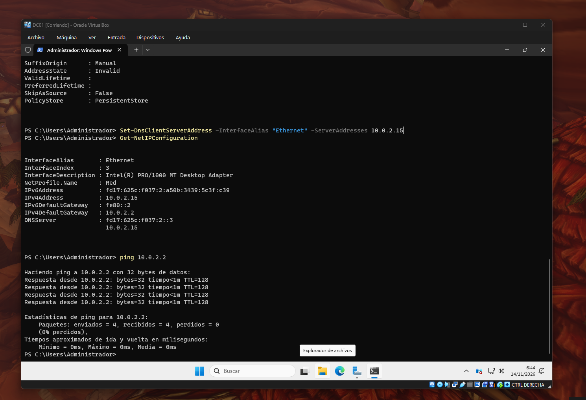
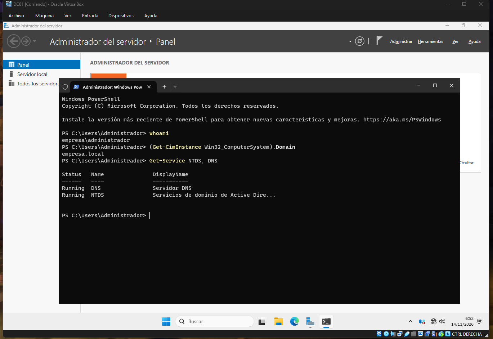
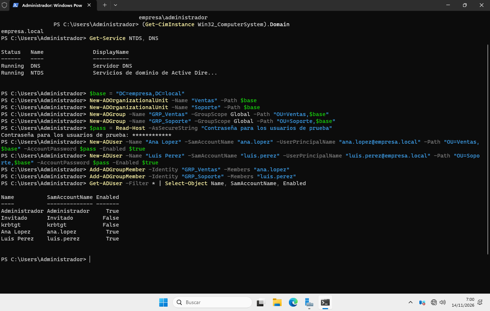
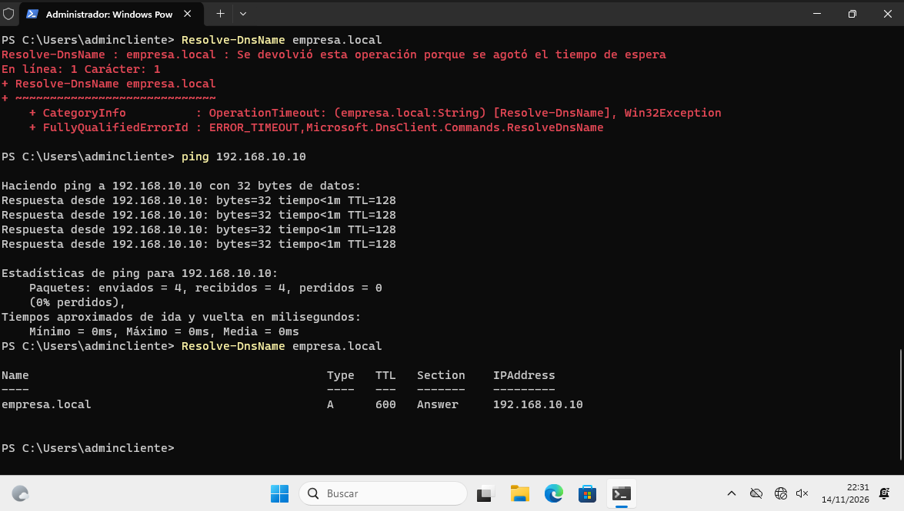
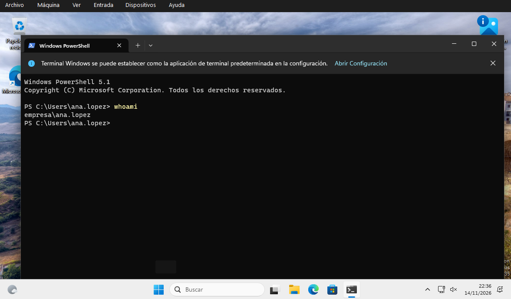
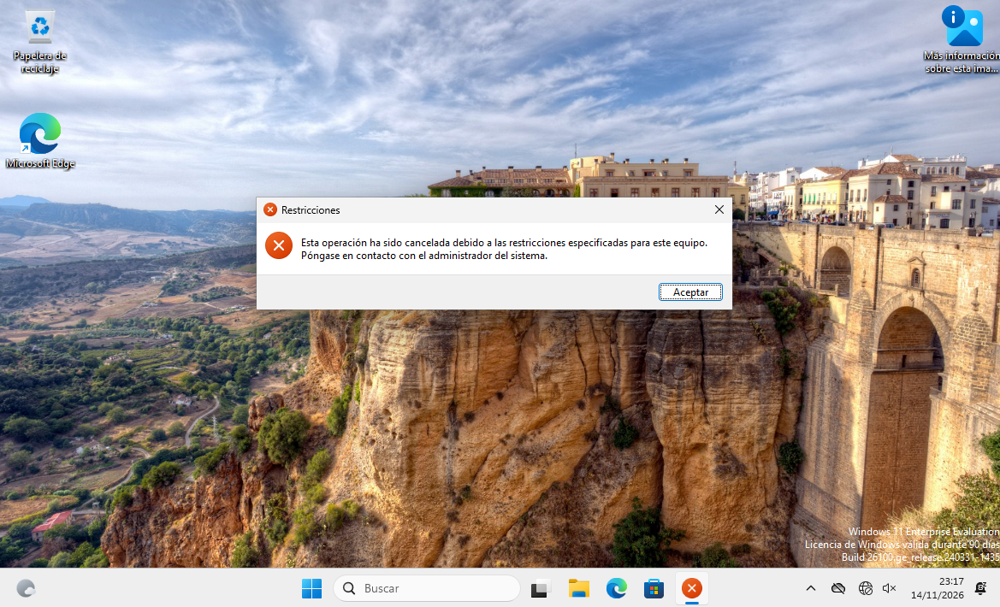
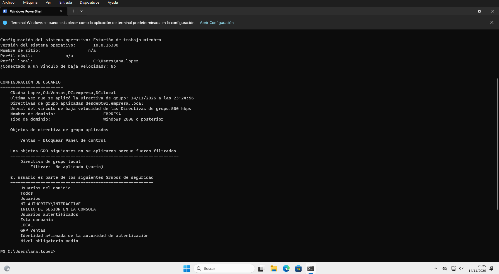
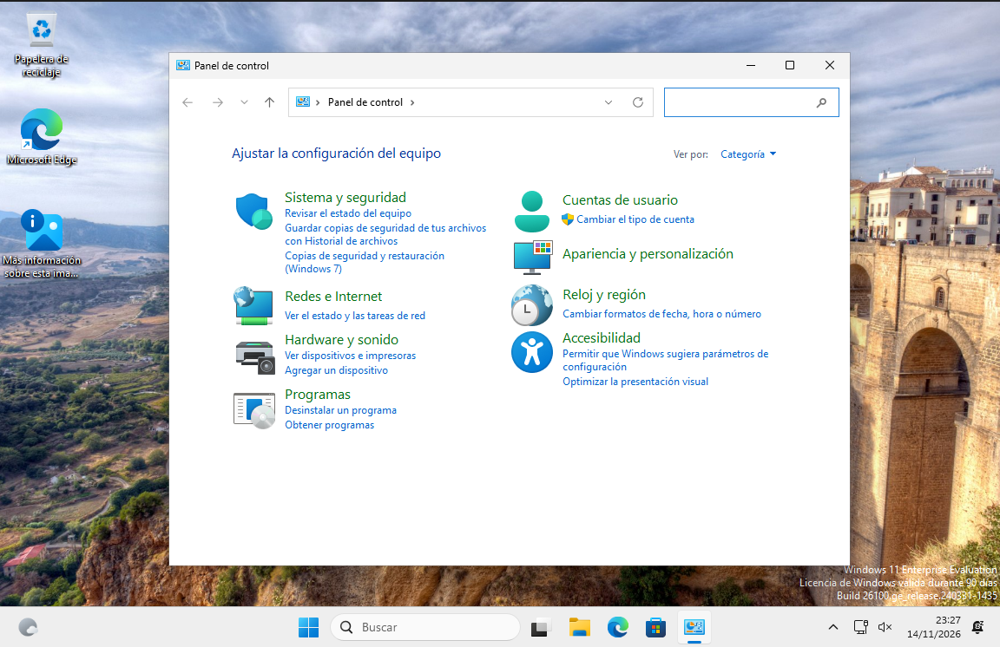

# Laboratorio de Active Directory con Windows Server 2025

Proyecto personal de laboratorio, montado en mi PC con VirtualBox, para practicar administración de sistemas y seguridad en un entorno parecido al de una empresa pequeña.

> Estado: en curso. El dominio, el cliente unido y las primeras GPO ya están montados; los siguientes pasos están al final.
>
> Este laboratorio continúa en un segundo proyecto: [deteccion-ataques-active-directory-wazuh](https://github.com/CarlosO207/deteccion-ataques-active-directory-wazuh), donde instalo un SIEM (Wazuh), simulo un ataque real contra estas mismas máquinas y lo analizo con MITRE ATT&CK.

## Objetivo

Montar desde cero un controlador de dominio con Active Directory, organizar usuarios y grupos, y documentar cada paso y cada problema que me encuentro. Más adelante lo ampliaré con un cliente Windows unido al dominio, un servidor Linux con copias de seguridad, un cortafuegos y monitorización de seguridad.

## Entorno

| Elemento | Detalle |
|---|---|
| Anfitrión | PC con Windows, AMD Ryzen 7 9700X, 32 GB de RAM |
| Virtualización | Oracle VirtualBox |
| Servidor | Windows Server 2025 Standard Evaluation (Desktop Experience), ISO de evaluación de Microsoft |
| Recursos de la VM | 4 vCPU, 6 GB de RAM, disco de 60 GB |
| Red de `DC01` | Adaptador 1 NAT (IP fija `10.0.2.15/24`, para internet) y adaptador 2 en red interna `labnet` (`192.168.10.10/24`) |
| Cliente | `CLIENT01`: Windows 11 Enterprise (evaluación), 4 GB de RAM, disco de 80 GB, red interna `labnet` (`192.168.10.20/24`) y NAT para internet |
| Nombre del equipo | `DC01` |
| Dominio | `empresa.local` (NetBIOS: `EMPRESA`) |

## Pasos realizados

### 1. Máquina virtual
- Creé la VM `DC01` en VirtualBox con la ISO de evaluación y la instalación desatendida desactivada, para hacer la instalación a mano.
- Instalé Windows Server 2025 con la edición con interfaz gráfica (Desktop Experience) y establecí la contraseña del administrador local.
- Instalé las Guest Additions de VirtualBox y activé el portapapeles bidireccional.



### 2. Nombre del equipo y red
```powershell
Rename-Computer -NewName DC01 -Restart

Set-NetIPInterface -InterfaceAlias "Ethernet" -Dhcp Disabled
New-NetIPAddress -InterfaceAlias "Ethernet" -IPAddress 10.0.2.15 -PrefixLength 24 -DefaultGateway 10.0.2.2
Set-DnsClientServerAddress -InterfaceAlias "Ethernet" -ServerAddresses 10.0.2.15
```
Comprobé la configuración con `Get-NetIPConfiguration` y la conectividad con `ping 10.0.2.2`. Active Directory necesita una IP fija y que el servidor use su propia IP como DNS.



### 3. Instalación del rol y creación del dominio
```powershell
Install-WindowsFeature AD-Domain-Services -IncludeManagementTools

Install-ADDSForest -DomainName "empresa.local" -DomainNetbiosName "EMPRESA" -InstallDns `
  -SafeModeAdministratorPassword (Read-Host -AsSecureString "Contraseña de recuperación") -Force
```
El servidor se reinició solo al terminar. Comprobé el resultado con:
```powershell
whoami                                          # empresa\administrador
(Get-CimInstance Win32_ComputerSystem).Domain   # empresa.local
Get-Service NTDS, DNS                           # ambos en Running
```



### 4. Estructura de la empresa
Creé dos unidades organizativas (`Ventas` y `Soporte`), un grupo de seguridad en cada una y un usuario de prueba por departamento, y los añadí a su grupo:

```powershell
$base = "DC=empresa,DC=local"
New-ADOrganizationalUnit -Name "Ventas" -Path $base
New-ADOrganizationalUnit -Name "Soporte" -Path $base
New-ADGroup -Name "GRP_Ventas" -GroupScope Global -Path "OU=Ventas,$base"
New-ADGroup -Name "GRP_Soporte" -GroupScope Global -Path "OU=Soporte,$base"
$pass = Read-Host -AsSecureString "Contraseña para los usuarios de prueba"
New-ADUser -Name "Ana Lopez" -SamAccountName "ana.lopez" -UserPrincipalName "ana.lopez@empresa.local" -Path "OU=Ventas,$base" -AccountPassword $pass -Enabled $true
New-ADUser -Name "Luis Perez" -SamAccountName "luis.perez" -UserPrincipalName "luis.perez@empresa.local" -Path "OU=Soporte,$base" -AccountPassword $pass -Enabled $true
Add-ADGroupMember -Identity "GRP_Ventas" -Members "ana.lopez"
Add-ADGroupMember -Identity "GRP_Soporte" -Members "luis.perez"
```

Comprobé el resultado con `Get-ADUser -Filter * | Select-Object Name, SamAccountName, Enabled`. Aparecen los dos usuarios nuevos habilitados, además de las cuentas que crea el propio dominio (`Administrador`, `Invitado` y `krbtgt`, estas dos últimas deshabilitadas por defecto).



### 5. Red interna y cliente unido al dominio
Con NAT las máquinas virtuales no se ven entre sí, así que añadí a `DC01` un segundo adaptador en una **red interna** de VirtualBox llamada `labnet`, compartida con el cliente.

En `DC01`:
```powershell
New-NetIPAddress -InterfaceAlias "Ethernet 2" -IPAddress 192.168.10.10 -PrefixLength 24
Set-DnsClientServerAddress -InterfaceAlias "Ethernet 2" -ServerAddresses 192.168.10.10
Set-DnsClient -InterfaceAlias "Ethernet" -RegisterThisConnectionsAddress $false
ipconfig /registerdns
```
La tercera línea evita que la IP del adaptador NAT se registre en el DNS del dominio, porque el cliente no podría alcanzarla.

En `CLIENT01` (IP fija y DNS apuntando al controlador de dominio):
```powershell
New-NetIPAddress -InterfaceAlias "Ethernet" -IPAddress 192.168.10.20 -PrefixLength 24
Set-DnsClientServerAddress -InterfaceAlias "Ethernet" -ServerAddresses 192.168.10.10
Set-DnsClientServerAddress -InterfaceAlias "Ethernet 2" -ServerAddresses 192.168.10.10
```
Comprobé la conectividad con `ping 192.168.10.10` y la resolución con `Resolve-DnsName empresa.local`.



Después uní el equipo al dominio y lo renombré:
```powershell
Add-Computer -DomainName "empresa.local" -NewName "CLIENT01" -Credential EMPRESA\Administrador -Restart
```
Tras reiniciar, inicié sesión con el usuario de dominio `EMPRESA\ana.lopez` y comprobé con `whoami` que la autenticación funciona contra el controlador de dominio.



### 6. Directiva de grupo (GPO)
Creé una directiva que bloquea el Panel de control a los usuarios de la unidad organizativa `Ventas` y la enlacé solo a esa unidad, para comprobar que afecta a unos usuarios y no a otros:

```powershell
New-GPO -Name "Ventas - Bloquear Panel de control" | New-GPLink -Target "OU=Ventas,DC=empresa,DC=local"
Set-GPRegistryValue -Name "Ventas - Bloquear Panel de control" -Key "HKCU\Software\Microsoft\Windows\CurrentVersion\Policies\Explorer" -ValueName "NoControlPanel" -Type DWord -Value 1
```

Las directivas de usuario se aplican al iniciar sesión, así que en `CLIENT01` ejecuté `gpupdate /force` y volví a entrar. Resultados:

- **`ana.lopez` (Ventas):** al intentar abrir el Panel de control, Windows muestra que la operación se canceló por las restricciones del equipo.

  

- **`gpresult /r /scope user`** confirma que la directiva se aplicó desde `DC01.empresa.local` y que el usuario pertenece al grupo `GRP_Ventas`.

  

- **`luis.perez` (Soporte):** el Panel de control se abre con normalidad, porque la directiva no está enlazada a su unidad.

  

## Problemas y soluciones

| Problema | Causa | Solución |
|---|---|---|
| No podía copiar y pegar comandos en la VM | Sin Guest Additions, VirtualBox no comparte el portapapeles | Instalé las Guest Additions y activé el portapapeles bidireccional |
| `netplwiz` no mostraba la casilla del inicio de sesión automático | Windows la oculta por defecto en esta versión | Añadí la clave de registro `DevicePasswordLessBuildVersion = 0` y volví a abrir `netplwiz` |
| Errores rojos en `Remove-NetIPAddress` y `Remove-NetRoute` | Al desactivar el DHCP, Windows ya había quitado la IP y la ruta antiguas | No era un error real: no había nada que borrar |
| Advertencias de delegación DNS al crear el dominio | No existe una zona DNS superior que delegue `empresa.local` | Normal en un laboratorio aislado; no requiere acción |
| El Administrador del servidor mostraba "Roles: 0" tras crear el dominio | El panel aún no se había actualizado | Verifiqué por PowerShell que el dominio y los servicios `NTDS` y `DNS` estaban activos |
| El cliente no podía hacer ping al servidor ("Host de destino inaccesible") | `DC01` estaba apagada y el cliente no tenía a quién alcanzar | Arrancar `DC01` y esperar a que los servicios de Active Directory estén listos antes de probar desde el cliente |
| Riesgo de que el cliente no encontrara el dominio | Windows podía preguntar por `empresa.local` a los DNS públicos del adaptador NAT | Configurar el DNS de `DC01` en ambos adaptadores del cliente |

## Lo que he aprendido

- Qué necesita un controlador de dominio: IP fija, DNS propio y un nombre de equipo definitivo antes de promocionarlo.
- Cómo instalar y configurar Active Directory Domain Services desde PowerShell.
- A verificar los resultados con comandos en lugar de fiarme del panel gráfico.
- A trabajar con instantáneas de VirtualBox para poder volver atrás si algo falla.
- Cómo montar una red interna aislada entre máquinas virtuales y por qué el DNS es lo primero que debe funcionar para unir un equipo a un dominio.
- Cómo funcionan las directivas de grupo: se enlazan a una unidad organizativa y solo afectan a los usuarios que están dentro, y se verifican con `gpresult`.
- A mover máquinas virtuales entre discos con la función "Mover" de VirtualBox, sin copiar carpetas a mano.
- A diagnosticar un fallo de red leyendo con atención el mensaje (en este caso, una respuesta de "host inaccesible" desde la propia IP del cliente).

## Próximos pasos

- [x] Crear unidades organizativas, grupos y usuarios de prueba.
- [x] Unir un cliente Windows al dominio.
- [x] Aplicar directivas de grupo (GPO) básicas.
- [x] Instalar Wazuh y analizar las alertas al atacar mi propio laboratorio — ver [deteccion-ataques-active-directory-wazuh](https://github.com/CarlosO207/deteccion-ataques-active-directory-wazuh).
- [ ] Ampliar las GPO: fondo de pantalla corporativo, unidades de red y reglas de contraseñas.
- [ ] Montar un servidor Linux con copias de seguridad automáticas.
- [ ] Añadir un cortafuegos (pfSense) y separar redes.

## Nota de seguridad

Todo el laboratorio es una red virtual aislada en mi propio equipo. Los usuarios y contraseñas son de práctica y no se reutilizan en ningún sistema real. No se incluye ninguna contraseña en este repositorio.
